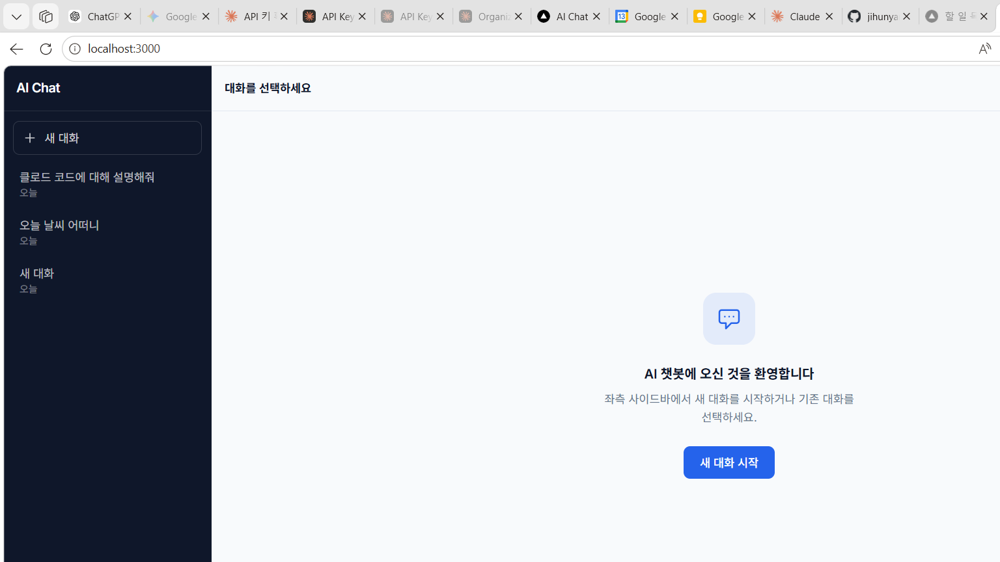

# AI Chat

Anthropic Claude API 기반의 범용 AI 대화 챗봇입니다.  
Next.js 풀스택으로 구성되며 대화 기록은 MongoDB에 저장됩니다.



## 주요 기능

- **실시간 스트리밍** — Claude API 응답을 타이핑 효과로 즉시 표시
- **대화 기록 저장** — 세션을 닫아도 MongoDB에 대화가 유지됨
- **다중 대화 관리** — 좌측 사이드바에서 대화 생성·전환·삭제
- **시스템 프롬프트** — 대화별로 AI의 역할·어조를 자유롭게 설정
- **다크/라이트 모드** — 시스템 설정 자동 감지 + 수동 전환
- **비즈니스 스타일 UI** — 네이비/슬레이트 팔레트, Inter + Noto Sans KR

## 기술 스택

| 영역 | 기술 |
|---|---|
| 프레임워크 | Next.js 16 (App Router) · TypeScript |
| AI | Anthropic Claude API (`claude-sonnet-4-6`) · 스트리밍 SSE |
| 데이터베이스 | MongoDB · Mongoose |
| 스타일링 | Tailwind CSS v4 |
| 상태 관리 | Zustand |
| 배포 | Google Cloud Run · Docker |

## 시작하기

### 요구 사항

- Node.js 20+
- MongoDB (로컬 또는 [MongoDB Atlas](https://www.mongodb.com/atlas))
- [Anthropic API 키](https://console.anthropic.com)

### 설치

```bash
git clone https://github.com/jihunyangAI/ai-chat.git
cd ai-chat
npm install
```

### 환경 변수 설정

`.env.local` 파일을 생성합니다.

```env
ANTHROPIC_API_KEY=sk-ant-...
MONGODB_URI=mongodb://localhost:27017/ai-chat
NEXT_PUBLIC_APP_NAME=AI Chat
```

### 로컬 MongoDB 시작 (선택)

MongoDB를 직접 설치한 경우:

```bash
# Windows
Start-Process "C:\Program Files\MongoDB\Server\8.3\bin\mongod.exe" -ArgumentList "--dbpath C:\data\db" -WindowStyle Hidden

# macOS / Linux
mongod --dbpath /data/db
```

### 개발 서버 실행

```bash
npm run dev
```

→ http://localhost:3000

## 프로젝트 구조

```
├── app/
│   ├── api/
│   │   ├── chat/route.ts              # 스트리밍 채팅 엔드포인트
│   │   └── conversations/
│   │       ├── route.ts               # 대화 목록 GET · 생성 POST
│   │       └── [id]/route.ts          # 대화 조회·수정·삭제
│   ├── layout.tsx                     # ThemeProvider 래핑
│   └── page.tsx                       # 메인 채팅 페이지
├── components/
│   ├── chat/
│   │   ├── ConversationSidebar.tsx    # 대화 목록 사이드바
│   │   ├── ChatWindow.tsx             # 메시지 목록 + 스크롤
│   │   ├── MessageBubble.tsx          # 메시지 버블 (user/assistant)
│   │   ├── InputBar.tsx               # 입력창 + 전송 버튼
│   │   └── SystemPromptModal.tsx      # 시스템 프롬프트 설정 모달
│   └── ui/
│       ├── ThemeToggle.tsx            # 다크/라이트 토글
│       └── ErrorToast.tsx             # 에러 알림 토스트
├── lib/
│   ├── claude.ts                      # Anthropic SDK 클라이언트
│   ├── mongodb.ts                     # MongoDB 싱글톤 연결
│   ├── store.ts                       # Zustand 전역 상태
│   ├── useChat.ts                     # 채팅 오케스트레이션 훅
│   └── types.ts                       # 공통 타입 정의
├── models/
│   ├── Conversation.ts                # 대화 세션 스키마
│   └── Message.ts                     # 메시지 스키마
├── scripts/
│   ├── deploy.sh                      # Cloud Run 배포 자동화
│   ├── create-secrets.sh              # GCP Secret Manager 등록
│   └── gcp-setup.md                   # GCP 초기 설정 가이드
└── Dockerfile                         # 멀티스테이지 프로덕션 빌드
```

## API 엔드포인트

| 메서드 | 경로 | 설명 |
|---|---|---|
| `POST` | `/api/chat` | 메시지 전송 + AI 응답 스트리밍 |
| `GET` | `/api/conversations` | 전체 대화 목록 |
| `POST` | `/api/conversations` | 새 대화 생성 |
| `GET` | `/api/conversations/:id` | 특정 대화 + 메시지 조회 |
| `PATCH` | `/api/conversations/:id` | 제목·시스템 프롬프트 수정 |
| `DELETE` | `/api/conversations/:id` | 대화 삭제 |

## 배포 (Google Cloud Run)

```bash
# 1. GCP 초기 설정 (최초 1회)
# scripts/gcp-setup.md 참조

# 2. 시크릿 등록
GCP_PROJECT_ID=your-project bash scripts/create-secrets.sh

# 3. 배포
GCP_PROJECT_ID=your-project bash scripts/deploy.sh
```

Cloud Run 스케일링 기본값: 최소 1 인스턴스 · 최대 2 인스턴스 · 동시 요청 10개

## 개발 명령어

```bash
npm run dev      # 개발 서버 (localhost:3000)
npm run build    # 프로덕션 빌드
npm run lint     # ESLint 검사
npx tsc --noEmit # TypeScript 검사
```
